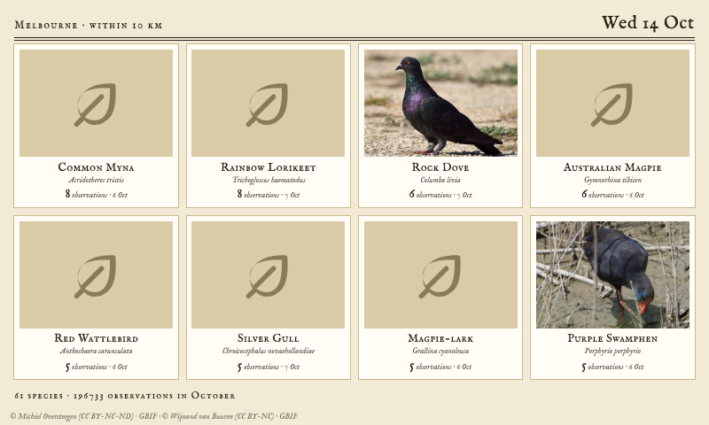
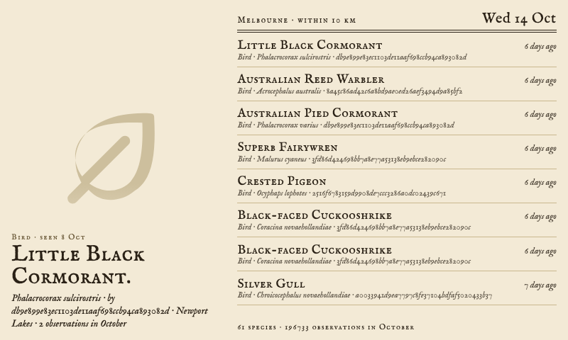
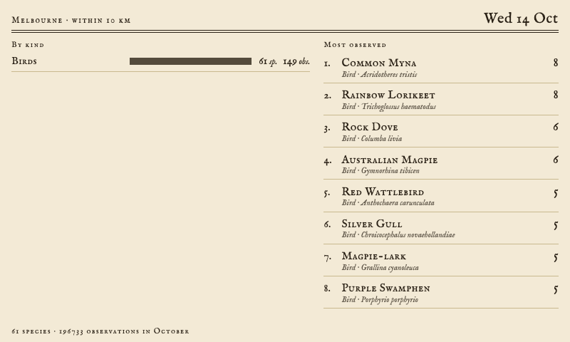

# Nature This Month (GBIF)

> **The collage page has moved.** The cluster / specimen-sheet page of this widget is superseded by [Specimen Sheet](https://github.com/dmellok/tesserae-widget-specimen-sheet), one widget for the page over BirdNET-Go, iNaturalist and GBIF, with model-made cut-outs, a balanced layout, eleven styles and a painted scene. Nature This Month keeps its other layouts and stays installable.

A [Tesserae](https://github.com/dmellok/tesserae) widget showing what has been recorded near a place in this month of the year, from the [Global Biodiversity Information Facility](https://www.gbif.org) (GBIF): birds, mammals, reptiles, insects, spiders, plants, fungi and more, as broad or as fine as you like.

GBIF's public occurrence API needs no account. The widget asks it one question per place, circle, set of kinds and month: the human observations within the circle in the current calendar month of any year, a page of 150. It groups that page by species, counts and sorts, so the page is what is historically about at this time of year, most recorded first. The answer is kept until the month turns (the month is part of the cache key), so a panel costs GBIF one call a month per place; common names and pictures of a species are kept half a year.

## Where and what

**Place** is the cell's location (or the app's), with **Within** setting the circle round it, 2 to 50 km.

**What to show** is a list of kinds you tick, from the broad (Birds, Mammals, Insects, Plants, Fungi) to the fine (Butterflies and moths, Dragonflies, Orchids, Ferns, Lichens, Bats, Frogs, Sharks and rays). They add up: Insects and Orchids together shows both. Nothing ticked shows everything. The kinds are taxa of GBIF's backbone; Reptiles and Flowering plants are several backbone taxa under one tick, since the backbone has no single name for them.

GBIF hands a page back in its own order, so the 150 records are a slice rather than a random sample: near a city the slice is often one dataset's birds. Tick the kinds you want to see and the slice is theirs.

## Layouts

| Layout | What it shows |
| --- | --- |
| Cluster | The most observed species on one page. With AI paintings, each is cut out of its painting and the cut-outs are packed together as a specimen sheet, a numbered plate with a key, a wreath round a title, a field notebook with taped-in pictures or a specimen drawer; with photos, a numbered montage with a key |
| Gallery | A card per species: a picture, name, scientific name, how many records and when it was last seen |
| Latest find | The newest record's picture to the edge of the page, with species, records and kinds counted beside it and the rest listed |
| Field log | The newest records in the sample as a list, each with its kind, scientific name, recorder and how long ago, beside the newest one's picture |
| Full bleed | The newest find's picture fills the cell, with a name band |
| Tally | A ledger of the kinds found, with species and records in each, and the most recorded species beside it |

Every layout adapts to portrait cells. The pages are printed matter, cream paper and engraved type (IM Fell English), with Playfair, typewriter, handwritten and modern faces to choose from, and a **Panel** option that converts the pictures for greyscale and black-and-white panels.

## Pictures

**Photos** are the picture a record carries where its dataset has media (iNaturalist-sourced records usually do; eBird's do not), else GBIF's pictures of the species, else none. Each is credited to its rights holder with the licence at the foot of the page.

**AI paintings** paint each species once, in the style you choose, from an openly licensed picture of it (the record's own where it is licensed, else the species' on GBIF, else iNaturalist's first licensed photo of the species as a last resort), through [fal.ai](https://fal.ai)'s nano-banana model at about US$0.04 a species. It needs a fal.ai key in the widget's settings, and a daily limit there keeps a busy place from painting the whole field guide at once. Painting takes longer than Tesserae gives a fetch, so it runs in the background, one new painting per refresh: the species shows its photo until the painting lands. Once a painting lands the widget also asks fal.ai's BiRefNet model for the same picture with its paper removed, so the cluster page cuts on the subject's true outline.

The 46 styles are the Backyard Birds widget's, word for word with the bird taken out: natural history plates and prints (Gould, Audubon, woodblock, engraving, linocut, field sketch, risograph, screen print, Charley Harper), the decorative styles round Art Nouveau (Mucha, Jugendstil, Glasgow, Vienna Secession, Art Deco, Morris, Japonisme, Rackham, Beardsley, Tiffany glass), period and ornament (chinoiserie, Persian miniature, bestiary, Byzantine icon, folk art, Delft, cigarette card), fine art, crafts (origami, paper cut, embroidery, felt, clay, bricks, stained glass, mosaic), playful looks and a few jokes, plus **Your own prompt**. The prompt knows what kind of thing it is painting: a bird perches on a branch, a mammal stands in profile, a fungus sits on its patch of ground as in a mycological plate, an insect is spread as in an entomological plate, a plant is a single stem as in a botanical plate.

The widget's page under **Widgets** lists every painting with its credit, paints a species on demand or a whole style at once, keeps earlier versions when a species is repainted, and shows a live ticker of what fal.ai is painting now.

## Cluster options

**How many species** is one number for the cluster page, the gallery (up to twelve) and how many species get an AI painting; the field log and the latest find take the newest records instead. **Look** picks the page; **Arrangement** where the specimens go (the look's own, an oval, a circle, a ring, rows, a scatter, a heap at the foot); **Sizes** how big each is drawn: by kind (a mammal large, an insect small, a plant in between), the most or the least observed biggest, or all alike. **Text** is the whole key, the labels under each specimen alone, or nothing, with **Label lines** choosing name, scientific name, kind, observations, when it was last seen and who saw it, at a **Text size** of your choice.

## Files

Under the widget's data folder: `result_<slug>.json` (GBIF's answer, aggregated, keyed on the place to two decimals, the circle, the kinds and the month), `names_<key>.json` and `media_<key>.json` (a species' common name and pictures from GBIF, kept half a year), `img/` (fetched pictures and resized copies), `gen/` (AI paintings, their cut-outs and credits, the daily budget, the last failure per species and the built cluster pages) and `gen/archive/` (earlier paintings).

The manifest declares `network:*` because the pictures a record carries come from whichever host its dataset uses. What the widget actually reaches: `api.gbif.org`, the picture hosts the records name (mostly `inaturalist-open-data.s3.amazonaws.com`), `api.inaturalist.org` only for a painting's reference when GBIF has no licensed picture, and `fal.run` only when AI paintings are on.

## Licence

AGPL-3.0. The bundled fonts carry their own licences in `fonts/`. A sibling widget, [Nature Nearby (iNaturalist)](https://github.com/dmellok/tesserae-widget-inaturalist), shows what people have found lately on iNaturalist, with a username filter; this one shows what is historically about at this time of year. Pictures belong to their rights holders under the licence each record carries; the credit line names them.
